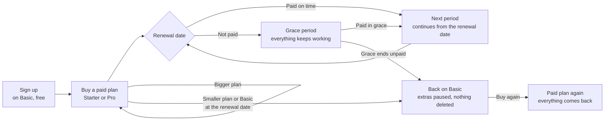
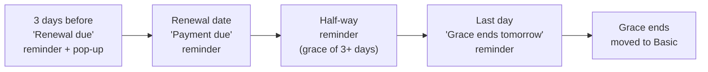
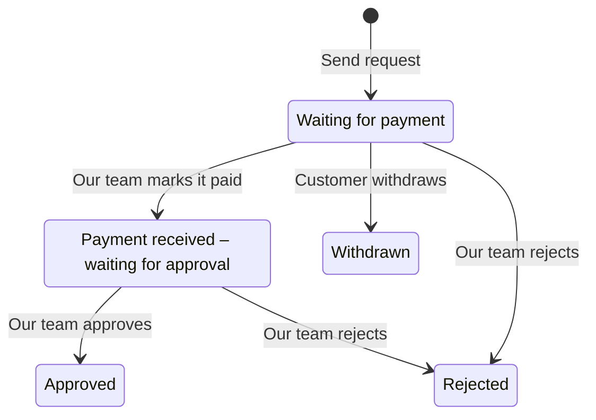

# Subscriptions and billing: how it works

A plain-language guide for the business team, sales and support staff, and Super Admins.
It describes how billing works today, in both payment modes. Where the screens use a
particular label, banner or tag, this guide uses the same words in quotes.

Example prices used throughout: **Basic** is free, **Starter** is ₹999 a month and **Pro** is
₹1,499 a month. GST is 18%. Your real prices are whatever is set in Plans & Pricing.

---

## 1. Overview

The billing system decides which plan each organisation is on, what that plan lets them do,
and how they pay for it. Customers buy, upgrade, downgrade and renew from **Settings →
Billing**. Every payment produces a GST invoice. When a renewal is missed, the organisation
gets a grace period and then moves to the free plan. Nothing is ever deleted: anything that
doesn't fit a smaller plan is paused and comes back when they pay again.

**Freemium.** Basic is free forever and every new organisation starts on it. Paid plans
(for example Starter and Pro) can be billed **monthly** or **yearly**. A month is always 30 days
and a year is always 365 days, counted from the moment of payment.

**Two payment modes.** One switch decides how customers pay:

| | Online payments ON | Online payments OFF (manual mode) |
|---|---|---|
| How the customer pays | Through Razorpay at the checkout ("Pay ₹X") | They send a request ("Send change request" / "Send renewal request") and our team confirms how to pay |
| When the plan changes | As soon as the payment succeeds | When a Super Admin marks the request paid and approves it |
| Who does the work | Nobody, it's automatic | A Super Admin, on the organisation's page: "Mark as paid", then "Approve" |

The switch is in the Super Admin console under **Integrations → Online payments**. It's off
until someone turns it on. Even when it's on, the system stays in manual mode if no payment
gateway has working keys, and the switch card says why.

Everything else works the same in both modes: what things cost, which changes are allowed,
grace, "Choose what stays", invoices and the Requests list. The only difference is "pay
now" versus "send a request".

**The overall journey**

---

## 2. Plans and limits

**What a plan controls**

| Limit or feature | What it means |
|---|---|
| Users | How many people can sign in. |
| Projects | How many projects can be edited. |
| Landing pages | How many landing pages can be published (live) at once. |
| Created landing pages | How many landing pages can exist in total, drafts included. This one can't be "paused" (see section 4). |
| Templates | How many templates the organisation can use to make new landing pages. |
| Team chat | On or off. |
| Meta lead ads | On or off, and how many Facebook pages can be connected. |

A limit can also be "Unlimited".

**Bigger or smaller?** Plans are ordered by price: Basic first, then by monthly price.
Moving to a pricier plan is an **upgrade**; moving to a cheaper one is a **downgrade**. On
the same plan, monthly → yearly counts as an upgrade and yearly → monthly as a downgrade.
The plan cards, the checkout and the downgrade page all use this one rule, so the arrow on a
card (↑ or ↓) always matches where it takes you. Typing a wrong address (for example
the checkout for a smaller plan) sends you to the right page.

**A pricier plan should give at least as much.** In Plans & Pricing, if a plan allows
fewer users, projects, landing pages or templates than a cheaper plan, the editor shows a
warning such as "Starter (₹999) allows fewer users than Basic (free)". It is a warning only;
it never stops a save.

**Prices are shown "+ GST"**, for example "₹1,499 + GST". GST is 18%: CGST 9% + SGST 9% when
the customer is in the same state as our company, otherwise IGST 18%. The state comes from the
customer's organisation details (Settings → General). Customers outside India are charged IGST
for now.

---

## 3. Customer flows, step by step

### a. Signing up on Basic

1. The customer fills in the sign-up wizard (account, then organisation).
2. At the last step the organisation is activated and put on **Basic**. Nothing to pay.
3. Settings → Billing shows "Free plan" with the Basic limits and a **Change plan** button.

Online and manual mode: the same. Super Admin: nothing to do.

### b. Buying a paid plan from Basic

1. Settings → Billing → **Change plan**. The plan cards show each plan's price "+ GST" and
   limits, with a Monthly / Yearly toggle ("Save ₹X a year" when yearly is cheaper than
   12 months).
2. They click **Change plan ↑** on Starter. The checkout shows their billing details (from
   Settings → General), a coupon box and the price summary: ₹999 + ₹179.82 GST = **₹1,178.82**.
3. If any invoice detail is missing, the button is disabled with "Complete your organisation
   details to continue".

| | What happens |
|---|---|
| **Online** | The button reads "Pay ₹1,178.82". Razorpay opens; once paid, Starter is active straight away, the period runs 30 days (or 365) from now, and the GST invoice is issued and emailed. A row "Change to Starter · Paid online · 27 Oct" appears in the Requests list. |
| **Manual** | The button reads "Send change request". A request appears in the Requests list as "Waiting for payment" and the banner says a request is pending. They stay on Basic until our team approves. |
| **Super Admin (manual)** | Opens the organisation from Package Requests, clicks **Mark as paid** (method, reference, date), then **Approve**. The plan starts and the invoice is issued and emailed. |

If the customer has more users, projects and so on than the new plan allows (rare when buying up),
they first pick what stays (section 4).

### c. Moving to a bigger plan mid-period

The customer pays only the **difference for the days left**, and the renewal date doesn't
change.

**Worked example.** On Starter monthly (₹999), renewing in 12 days. They move to Pro (₹1,499).

| Step | Amount |
|---|---|
| Difference per month | ₹1,499 − ₹999 = ₹500 |
| For 12 of 30 days | ₹500 × 12 ÷ 30 = **₹200** |
| GST 18% | ₹36 |
| **Pay now** | **₹236** |
| Renewal date | Unchanged; from then on Pro renews at ₹1,499 + GST |

The checkout shows this as "prorated". Days left are counted up, so a part day counts as a full
day.

**Monthly → yearly** is a little different: they pay the full yearly price **minus a credit
for the unused part of the current month**, and a new yearly period starts today. Example:
if Pro yearly were ₹14,990 with 12 days left on Pro monthly, the credit is ₹1,499 × 12 ÷ 30 =
₹599.60, so they pay ₹14,390.40 + GST. The checkout shows it as "less monthly credit".

**Yearly → monthly** can't be done mid-year; it is a downgrade at the renewal date (flow d).

Online: paid at once and applied at once. Manual: a change request, applied when our team
approves it. The approval uses the same calculation.

### d. Moving to a smaller plan or to Basic while the plan is paid

Nothing to pay. The change is **scheduled for the renewal date**; until then they keep
everything.

1. On the plan cards they click **Change plan ↓** on a cheaper plan or Basic.
2. The downgrade page shows what changes, "Takes effect" with the date, and, if they're over
   the smaller plan's limits, the two "Choose what stays" options (section 4). The button stays
   disabled until they pick one.
3. They confirm ("Change to Starter on 26 Nov?", button "Schedule plan change"; for Basic,
   "Move to Basic").
4. The banner now reads **"Change to Starter scheduled for 26 Nov 2026"** (or "Change to
   Basic scheduled for …"), with a **Keep Pro** button to undo it.
5. The Requests list shows the change as "Scheduled (applies on 26 Nov)" with "No approval
   needed".
6. On the renewal date the plan switches. A smaller paid plan then needs paying for its next
   period like any renewal; Basic needs nothing.

While a change is scheduled, other plan changes are blocked with "You've scheduled a change to
Basic on 25 Nov 2026. Click 'Keep Starter' to undo it before choosing another plan."
Renewing is still allowed (at the smaller plan's price).

Scheduling a downgrade also **closes any unfinished online payment** the organisation had open
(it shows "Superseded").

The same in both modes. Super Admin: nothing to do.

### e. Renewing

Paid plans are "pay each time"; nothing is charged automatically.

1. **3 days before the renewal date** (the "Notify days before expiry" setting), the status
   becomes "Renewal due" and:
   - the org's admins get an in-app notification "Your plan renews on 26 Nov 2026";
   - the banner reads "Your Pro plan renews on 26 Nov 2026 · Pay ₹1,768.82 before then to
     keep everything running";
   - a pop-up "Your Pro plan renews in 3 days" opens once per renewal date ("Remind me later"
     closes it).
2. Before that window, renewing isn't offered ("You can pay for it from 3 days before").

| | What happens |
|---|---|
| **Online** | "Pay now · ₹1,499 + GST". Razorpay opens; once paid, the **next period starts from the renewal date**, not from today, so paying early loses no days. |
| **Manual** | "Request renewal · ₹1,499 + GST" opens the renewal request ("Send renewal request"). While it waits the button reads "Renewal requested". Our team marks it paid and approves; the period continues from the renewal date. |

If a smaller plan is scheduled, the renewal is charged at that plan's price and the plan
switches then. A renewal coupon (section j) is taken off automatically.

### f. Renewal missed: the grace period

If the renewal date passes unpaid, the organisation goes into **grace** (default 7 days,
counted from the renewal date, plus any extra days a Super Admin gives).

- **Everything keeps working** during grace: sign-ins, projects, publishing and leads.
- Status: "Payment due". On the last day: "Grace ends tomorrow".
- Banner: "Your Pro renewal (₹1,499 + GST) was due on 26 Nov 2026", with a countdown ("5 days
  left") and "Day 3 of 7. Everything keeps working until 3 Dec 2026; after that you move to
  Basic."
- On the last day the banner changes to "Grace ends tomorrow — on 3 Dec 2026 Acme moves to
  Basic" and lists what would stay active on Basic.
- Buttons: "Pay now" (online) or "Request renewal" (manual), and "Choose what stays"
  (for the move to Basic). Manual mode also shows "Change plan" on the banner; online
  customers use Change plan in the action row.
- Reminders (in-app, to the org's admins): on the due date, half-way through grace (only if grace
  is 3 days or more), and on the last day.

### g. Changing plan during grace

In grace there is no paid period left to prorate against, so:

- **Any paid plan**, bigger, smaller or the same, costs its **full price + GST**, and the new
  period **continues from the missed renewal date**. Example: Starter overdue since 26 Nov, they
  pick Pro on 29 Nov: they pay ₹1,499 + ₹269.82 = ₹1,768.82, and Pro runs to 26 Dec, not 29 Dec.
  The checkout shows an "overdue renewal" tag and explains this. No coupon code can be typed;
  a renewal coupon already on their plan still applies.
- **Basic** happens **straight away**, with no payment: "Move to Basic now?" → anything over Basic's
  limits is paused.

| | Paid plan in grace | Basic in grace |
|---|---|---|
| **Online** | Plan cards send every paid plan to the checkout ("Pay now" on their current plan, "Change plan" on the others); pay → applied at once. | Moves at once. |
| **Manual** | A change request at full price ("Request renewal" on the current plan, "Send change request" on others); applied when approved. | Moves at once, no request. |

### h. Grace ends unpaid: automatic move to Basic

When grace ends:

1. The organisation moves to **Basic**.
2. Whatever doesn't fit Basic is paused, using their "Choose what stays" picks or our default
   picks (section 4). **Nothing is deleted** and leads keep coming in.
3. Banner: **"You're on Basic now — Pro ended on 3 Dec 2026"**, with the counts ("2 users
   paused, 3 projects view-only, 4 landing pages offline") and **"Buy Pro again ·
   ₹1,499 + GST"**.
4. What stays is now view-only for the customer: "To change what stays, contact our support
   team".

In manual mode, a request still waiting when grace ends doesn't stop the move. The request
stays pending with the note "Org moved to Basic while waiting"; if it's approved later, the
plan comes back and the new period starts on the date the payment was received.

(See "Things to check" for a server setting this depends on.)

### i. Buying again after moving to Basic

1. "Buy Pro again" (or any plan from Change plan) → the checkout at the full price.
2. Once paid (online) or approved (manual), the plan starts today and **everything that fits
   comes back straight away**: users can sign in, projects are editable, landing pages go
   live again, templates are usable.

### j. Coupons

- **Where customers find them:** Settings → Billing → **Coupons** lists coupons reserved for
  their organisation and open coupons our team chose to show. Each says "Available",
  "Expired", "Used up" or "Redeemed" (with the invoice). "Use at checkout" opens the plans with
  the code ready.
- **At checkout:** type the code in the coupon box. It's checked against the plan, monthly or
  yearly, the dates, total uses and once-per-organisation. The discount comes off **before
  GST**. Example: 20% off Pro: ₹1,499 − ₹299.80 = ₹1,199.20 + ₹215.86 GST = ₹1,415.06.
- **How long it lasts:** "First payment only", "First N renewals" (counting the first
  payment) or "Forever". A coupon that lasts beyond the first payment stays on the plan and is
  taken off renewals automatically while it covers the plan they're on.
- **100% coupons:** if the total is ₹0, the button reads "Activate Pro — nothing to pay" and
  the plan starts at once, in either mode, with no Razorpay step and no invoice.
- **Not possible:** typing a code during grace (only an existing renewal coupon applies), and
  an online total under ₹1 ("This change costs less than ₹1 … Contact us and we'll switch it
  for you").
- **Manual mode:** customers can't type a code on a request; our team adds a coupon to the
  request (see 6).

### k. Invoices and payment history

- Every paid change or renewal gets a **GST tax invoice**, numbered per financial year
  (April–March), for example **INV/26-27/0007**. It shows our company details, the customer's
  details, the plan, any coupon and the GST split.
- It is **emailed once** to the organisation's owner and admins, and can be opened or
  downloaded from Settings → Billing (Invoices and Payments), from the payment success page,
  and from the Requests list ("Invoice …" on a paid online row).
- A **refund** produces a **credit note** (for example CN/26-27/0002), also emailed.
- ₹0 activations have no invoice.

---

## 4. "Choose what stays"

**When it appears.** Whenever a change would put the organisation over the new plan's limits
for users, projects, published landing pages or templates. That happens on a downgrade, a move
to Basic, a plan change in grace, and the move to Basic at the end of grace.

**The two options** (one must be picked every time; neither is pre-selected):

- **Keep the default picks**: the list we'd keep is shown underneath.
- **I'll choose what stays**: opens the Choose what stays screen with tick lists. After
  "Save" they come back to the same page with "I'll choose" selected and their picks listed, with
  **Edit**.

The main button ("Pay …", "Send change request", "Schedule plan change", "Move to Basic") stays
disabled until an option is picked. With "I'll choose", it also needs a saved choice that still
fits the plan.

**How the default picks are chosen**

| Item | Kept first |
|---|---|
| Users | The owner (the organisation's first account, who always stays), then admins, then whoever signed in most recently. |
| Projects | The most recently updated. |
| Landing pages | The ones with the most leads in the last 30 days. |
| Templates | The ones used for the most landing pages, then the most recently used, then the most recently added. |

On the Choose what stays screen, a list that already fits the plan has nothing to untick: it
says "All … stay active" and every item stays.

**What "paused" means.** Nothing is ever deleted, and **leads keep coming in**.

| Item | When it doesn't stay |
|---|---|
| User | **Paused**: can't sign in (signed out at once) and isn't given new leads. |
| Project | **View only**: can be opened, not edited. |
| Landing page | **Offline**: unpublished until it stays again. |
| Template | **Paused**: can't be used for *new* landing pages. Pages already made from it stay live and editable. |

Created landing pages (drafts included) over the limit can't be paused. A plan with fewer of
those is refused until the customer removes some ("Choose a bigger plan").

**When it can still be changed**

- **The customer** can change it until the change is decided or takes effect: before sending,
  while a request is "Waiting for payment", while a downgrade is scheduled, and during grace.
  After that, the Requests list shows "View" and the screen says "To change what stays,
  contact our support team".
- **Our team** can change it any time, on the organisation's latest request row (or, only when
  no request set the current plan, from the organisation page). If the organisation is already on
  that plan, the change applies straight away and the organisation is notified.
- There is one place to change it: the latest request. Older rows are history ("What stayed
  when this change applied on …").

**On upgrade**, everything that fits the new plan comes back immediately.

---

## 5. The Requests list (customer side)

Settings → Billing → **Requests** lists every plan change, newest first, 10 per page:
manual requests, online payments and scheduled changes. Columns: when and who, the change
("Change to Pro", "Renewal of Pro", with an "overdue renewal" tag when sent in grace), the
amount ("₹1,499 − ₹300 coupon + GST" and the total incl. GST), **what stays**, the status and
the decision date.

**Manual requests**

| Status | Meaning |
|---|---|
| Waiting for payment | Sent; our team hasn't recorded a payment yet. The customer can **Withdraw** it. |
| Payment received – waiting for approval | Our team recorded the payment. "Contact us to withdraw". |
| Approved | Applied. |
| Rejected | Not applied; the reason our team gave is shown, and the Billing page shows it too. |
| Withdrawn | The customer withdrew it. |

Only one request can wait at a time ("You already have a pending request (Starter → Pro, sent
22 Oct). Wait for approval or withdraw it."), and while it waits other plan changes are
disabled.

**Online payments** (read-only, nothing to approve)

| Tag | Meaning |
|---|---|
| Waiting for payment | The Razorpay window was opened and not yet paid. |
| Paid online · 27 Oct | Paid and applied. Shows the order ID and the invoice. |
| Payment failed | Razorpay reported a failure. Nothing changed. |
| Expired (not paid) | Not paid within 30 minutes. Nothing changed. |
| Superseded | Closed because a newer payment was started or a downgrade / Basic was scheduled. Nothing changed. |
| Needs review | Paid, but not applied; our team is checking it (section 6). |
| Refunded | Our team refunded it. |
| Resolved by our team | Our team closed the review by hand. |

**Scheduled changes** (tag "No approval needed"):

| Status | Meaning |
|---|---|
| Scheduled (applies on 26 Nov) | Will happen at the renewal date. **Keep Pro** undoes it. |
| Done | Took effect ("Took effect 27 Oct 2026"). |
| Undone | The customer clicked "Keep …". |
| Replaced | Something else happened first (an upgrade, a renewal or another change). |

**What stays column:** "Keeps 3 of 5 projects" (or "Everything fits"), with **Change what
stays** on the latest row while it's still open, and **View** on every other row.

---

## 6. Super Admin guide

### Plans & pricing

Subscriptions → **Plans & Pricing**: create and edit plans (name, monthly and yearly price,
limits, team chat, Meta lead ads and pages). The editor shows the yearly saving ("17% cheaper
than 12 × monthly") and warns, without blocking, when a plan allows less than a cheaper one.
Basic is the free system plan. Internal ₹0 plans (such as a demo plan) are never offered to
customers.

### Coupons

The **Coupons** page: create a code with a type (percent or a rupee amount before GST), the
plans and billing (monthly / yearly / any) it works on, how long it lasts ("First payment
only", "First N renewals", "Forever"), valid from / until, total uses (counts organisations)
and "once per organisation". **Only specific organisations** reserves it. **Show in customers'
coupon list** makes an open coupon visible on customers' Coupons page. Each coupon shows
"Active", "Scheduled", "Expired" or "Used up", and "Who used it" lists every payment it
reduced.

### Organisation subscriptions

Subscriptions → **Organisation Subscriptions** lists every organisation with filters by status
and plan. Opening one shows, top to bottom:

1. **Action row**
   - **Extend grace**: only during grace. Adds 1, 3, 5, 7 or 14 days, with an optional note.
     Everything keeps working until the new date.
   - **Cancel**: moves a paid organisation to Basic, either "At the end of the period
     (date) — access continues until then" or "Straight away — moves to Basic now (no
     automatic refund)", with an internal reason.
   - **Choose what stays**: only when no request set the organisation's current plan (assigned
     directly, or moved to Basic without a request). Otherwise it's on the latest Package
     requests row. Only one of the two ever shows.
   - *Mark paid offline* and *Apply coupon* are **hidden for now** in both modes. In manual
     mode those things are done on the request instead.
2. **Plan summary**: plan, status, the key date (renews / grace ends …), renewal type, users.
3. **Package requests** for this organisation (below).
4. **Payments**: with order IDs and invoices.
5. **Timeline** (bought, renewed, missed payments, grace, moved to Basic, refunds …) and
   **Coupon in use**.

### Package requests: manual mode

On the organisation page, **Package requests**, newest first:

1. **Mark as paid**: method (Bank transfer, UPI, Cheque, Cash, Other), reference, date
   received, note. The amount is the request total. "Edit payment" changes it; it can be
   cleared.
2. **Approve**: applies the plan with the request's price rule. The new period starts as
   described in section 3 (from today for a purchase, the renewal date stays for an upgrade, from
   the renewal date for renewals and overdue changes, from the payment date if the org fell back
   to Basic while waiting). Issues and emails the invoice. Approve is disabled until the
   request is marked paid.
3. **Reject**: a reason (10–500 characters) is required and the customer sees it. If it was
   marked paid, the dialog reminds you to refund the customer outside the app; that payment is
   listed as "rejected – refund due".
4. **Coupons on a request**: a coupon is added or removed at the top of the **Mark as paid**
   dialog. The request is recalculated; a payment already recorded is cleared and must be
   marked again. If the coupon makes it ₹0, there's nothing to mark paid ("Edit coupon"), and
   you approve it directly.
5. Overdue requests carry the "overdue renewal" tag and are priced at the full price.
6. **Choose what stays** on the latest row; **View what stays** on older rows.

The overall Package Requests tab lists requests from every organisation (Pending / All /
Approved / Rejected) with **Open**, which takes you to that organisation's section.

### Package requests: online mode

Online payments appear as **read-only rows** (tag, order ID, invoice, "Online payment · no
approval"). There is no Approve, Reject or Mark as paid.

**Needs review** means the customer paid but the plan wasn't applied, for example:

- the amount didn't match the quote;
- the plan changed after the price was quoted;
- the organisation went over the plan's limits and hadn't chosen what stays, or their saved
  choice no longer fits;
- the payment arrived for a checkout that was already superseded ("Paid after a newer
  change").

Super Admins get a "Plan payment needs review" notification. The payment is listed under
Package Requests → **Paid — needs review**, and the org row's "Needs review →" links there with
the reason. **While a payment is under review, that organisation can't change plans** ("A
payment is being checked by our team. You can change plans once it's resolved."); renewals still
work. Resolve it one of two ways:

- **Refund** it (Payments & Invoicing → Refund). The credit note is issued, the row shows
  "Refunded" and the block lifts.
- Fix the plan by hand, then click **Mark resolved** on the review list (optional note). Nothing
  is applied; the row shows "Resolved by our team" and the block lifts.

### Payments & invoicing

Every plan payment from every organisation: date, organisation, description, amount, method,
status (Paid, Failed, Refunded, Paid offline), coupon, Razorpay order and payment IDs (searchable)
and the invoice. **Refund** refunds a paid payment in full (through Razorpay for online payments)
and issues a credit note, which is emailed.

### Settings

- **Integrations → Online payments**: the on/off switch, and the payment gateways
  (Razorpay keys under **Manage**). Without working keys it stays in manual mode and says why.
- **Company & tax details**: our legal name, GSTIN, state and address, printed on every
  invoice. Without a state, GST is charged as IGST (with a warning).
- **Subscription expiry policy**: "Notify days before expiry" (default 3), "Grace period
  (days)" (default 7), "When grace period ends" (always "Fall back to Basic"), and the
  "Expiry notification message" used in the "renews soon" notification.
- **Reminder schedule**: switch each in-app reminder on or off (before renewal, payment day,
  mid-grace, last day of grace). A switched-off reminder isn't sent; the plan changes still
  happen.
- **Run lifecycle check now** ("Run now"): applies due renewals, grace, moves to Basic,
  scheduled changes and reminders immediately instead of at the next hourly check. Recorded in
  the audit log.

---

## 7. Automatic things

A background check runs **every hour**. It also runs for an organisation whenever someone in
it opens Billing or tries to publish, so screens are never out of date.

| What | When exactly |
|---|---|
| "Renews soon" reminder | Once per renewal date, from 3 days (the setting) before the renewal time. |
| Into grace ("Payment due") + payment-day reminder | When the exact renewal time passes. |
| Mid-grace reminder | Once, from half-way through grace, only if grace is 3 days or more. |
| Last-day reminder ("Grace ends …") | Once, when less than 24 hours of grace are left. |
| Grace ends → moved to Basic | When renewal time + grace days (+ any extension) passes. |
| Scheduled downgrade / move to Basic | At the exact renewal time. |
| Unpaid online payments expire | 30 minutes after the Razorpay window was opened (shown as expired at the next check or page load). |

**Timing rules in plain words**

- Periods are measured in exact 24-hour days from the moment of payment, not calendar months.
  Bought at 3:00 pm on 1 Oct: monthly renews at 3:00 pm on 31 Oct.
- Every change happens at that **same time of day** (at the next hourly check at the latest),
  not at midnight.
- **Dates shown on screens, notifications and invoices use the UTC calendar day**, not Indian
  time. Something due at 3:00 am IST on 2 Nov shows as "1 Nov".
- Reminders are **in-app notifications** to the organisation's admins; they are not emailed.
  Invoices and credit notes are emailed.

---

## 8. Rules at a glance

Prices: Starter ₹999, Pro ₹1,499 a month, + 18% GST. "Applies" means when the plan actually
changes.

| Situation | Bigger plan | Smaller paid plan | Basic | Renew same plan |
|---|---|---|---|---|
| **Paid period**, online | Pay the difference for the days left (e.g. ₹236); applies at once; renewal date unchanged | Pay nothing now; applies at the renewal date | Pay nothing; applies at the renewal date | From 3 days before: pay full price; next period continues from the renewal date |
| **Paid period**, manual | Request for the same prorated amount; applies when approved | Same as online | Same as online | Renewal request at full price; applies when approved, period continues from the renewal date |
| **Grace**, online | Full price (₹1,768.82 for Pro); applies at once; period continues from the missed date | Full price; applies at once; period continues from the missed date | Free; applies at once | Full price; period continues from the missed date |
| **Grace**, manual | Request at full price; applies when approved; period from the missed date | Same as bigger | Free; applies at once (no request) | Renewal request at full price |
| **On Basic**, online | Full price; applies at once; new period from today | Full price; applies at once | Already there | Nothing to renew |
| **On Basic**, manual | Request at full price; applies when approved | Same | Already there | Nothing to renew |

Blocks that apply in every situation:

- a manual request is waiting ("You already have a pending request …");
- a change is scheduled ("Click 'Keep …' to undo it before choosing another plan");
- a payment is under review ("A payment is being checked by our team …").

Renewals stay allowed during a scheduled change and during a review.

---

## 9. FAQ

**Why was I charged only part of the price?**
You moved to a bigger plan before your renewal date, so you only paid the difference for the
days left (for example ₹200 + GST for 12 days, Starter → Pro). Your renewal date stays the
same, and from then on you pay the full Pro price.

**Why was I charged the full price for a plan change?**
Your renewal was overdue (grace). With no paid period left, any plan costs its full price, and
the new period starts from the date your renewal was due, so you don't lose those days.

**Why is my project view only?**
Your organisation moved to a plan with fewer projects, and that project wasn't one of the ones
kept. It's not deleted. Buy a plan with enough projects and it's editable again straight away.

**Why can't one of our team sign in?**
They were paused because the plan allows fewer users. Nothing about them is deleted. A bigger
plan brings them back, or our team can change which users stay.

**What happens to my leads?**
Leads keep coming in on every plan, including Basic, even for paused items. Nothing is
deleted.

**Why did my landing page go offline?**
The plan allows fewer published pages and this one wasn't kept. It comes back online when
it's kept again or you move to a bigger plan.

**Can I change what stays later?**
Yes, until the change is decided or takes effect (while a request waits, while a downgrade is
scheduled, during grace). After that, contact our support team and we can change it for you.

**Why was my request rejected?**
The reason our team gave is shown on the Billing page and in the Requests list. You can send
a new request any time.

**The payment succeeded but my plan didn't change. Why?**
If it shows "Needs review", our team is checking it (for example, the price changed, or you
went over the plan's limits while paying). You'll get your plan or a refund. Until it's
resolved, plan changes are on hold; renewing still works. If it shows "Waiting for payment"
for a while, the payment may still be processing; check again in a few minutes.

**How do I get a refund?**
Contact our support team. We refund through Razorpay (or outside the app for manual payments)
and you get a credit note by email.

**What happens if I don't renew?**
Your plan keeps working through the grace period (7 days by default). After that you move to
Basic: what doesn't fit is paused, never deleted. Buy again and everything comes back.

**Can I switch from yearly to monthly?**
Yes, at your renewal date (it's scheduled like a downgrade). Monthly to yearly can be done any
time; you get a credit for the unused part of the month.

**Can I cancel a scheduled downgrade?**
Yes: click "Keep <your plan>" on the banner or in the Requests list before the renewal date.

**I opened the payment window twice. Will I be charged twice?**
Only the latest payment window counts. If an older one is paid anyway, nothing is applied
twice: it goes to our team for review and is refunded.

**Where do I find my invoices?**
Settings → Billing (Invoices and Payments), in the email we send after each payment, and on the
paid row in the Requests list.

**Why can't I use my coupon?**
It may be for other plans or billing (monthly / yearly), expired, used up, already used by your
organisation, or not usable on an overdue renewal. The checkout says which.

---

## 10. Things to check

Places where the code and the reference document differ, or where behaviour looks inconsistent.
Each describes what the system does today.

1. **Grace end depends on a server setting.** Moving to Basic when grace ends only happens when
   the "billing v2" switch is on in the **server's** configuration (or the expiry policy was
   saved as "Fall back to Basic"). Without it, the old default applies: the organisation stays
   on its plan as **"Expired"**, with publishing stopped, instead of moving to Basic. The settings
   screen always shows "Fall back to Basic", so the screen can disagree with what happens. Confirm
   the server switch is on in production.
2. **Dates use UTC, not Indian time.** All dates on screens, notifications and invoices (and the
   invoice financial year) use the UTC calendar day, and changes happen at the exact time of day
   of the original payment. The original plan asked for Indian-time whole days; that isn't done
   yet.
3. **Months are 30 days and years 365 days.** Renewal dates drift against calendar months
   (1 Oct → 31 Oct → 30 Nov …).
4. **Reminders are in-app only.** They aren't emailed and don't state the amount. Only invoices
   and credit notes are emailed.
5. **Super Admin "Cancel → At the end of the period" goes through the customer's own Basic
   flow.** For an organisation over Basic's limits it may be refused with "choose what stays"
   (there's no option on the Super Admin dialog). It's also refused while a change is scheduled
   or a payment is under review, and in grace it moves the organisation **at once**, not at the
   end of the period. **"Straight away"** skips those checks and doesn't close an unfinished
   online payment.
6. **"Mark paid offline" and "Apply coupon" are hidden in the UI but still work behind it.** They
   were commented out on the organisation page for now. In online mode the server still accepts
   them (it refuses them in manual mode). The button the business team called "Record offline
   renewal" is this "Mark paid offline" action.
7. **An older sign-up route can start a paid plan without payment.** The sign-up wizard always
   assigns Basic, but an older registration route still accepts a chosen plan and makes it
   active straight away with no payment. Check nothing still uses it.
8. **100% coupon activations aren't on the Requests list.** A ₹0 activation applies the plan and
   records the coupon but makes no request row and no invoice, so it doesn't count as the
   "latest request" for Choose what stays.
9. **Wording differs from the reference document.** The document says the manual checkout
   button is "Send upgrade request"; the screen says "Send change request" (and "Send renewal
   request" for renewals).
10. **The online grace banner has no "Change plan" button.** The manual one does. Online customers
    can still use Change plan in the action row.
11. **Resolving a review is recorded as "rejected" internally.** Both Refund and Mark resolved set
    the payment's checkout to a "rejected" state behind the scenes. Reports that count rejected
    checkouts will include them. The review list itself has no Refund button; refunds are done
    from Payments & Invoicing.
12. **Expired online payments show up late.** They expire after 30 minutes but are marked
    "Expired (not paid)" at the next hourly check or the next time a billing page loads.
13. **If no Basic plan exists, a built-in fallback applies.** The fallback allows 1 user, 1
    project, 1 template, 1 published and 2 created landing pages. Make sure the Basic plan exists
    and is active.
14. **Customers outside India are charged IGST.** The export-of-services treatment isn't done
    yet.
15. **A pending manual request doesn't stop the move to Basic.** This is intentional, but support
    should know: the customer may be on Basic while their request still says "Waiting for
    payment" with "Org moved to Basic while waiting".
